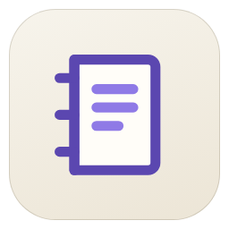

<h1 align="center">Konnash</h1>

<b>AI for Scholars</b>

<a href="https://github.com/Yrooma/konnash/releases/latest/download/konnash.xpi"><b>Download konnash.xpi</b></a> · <a href="https://yrooma.github.io/konnash/">Website</a> · <a href="README.ar.md">العربية</a> · <a href="PRIVACY.md">Privacy</a>

---

Ask about the PDF you are reading. Every answer points to the sentences it
comes from, lit up in your PDF.

**The reading stays yours.** Konnash sends you back to the text. It does not
read for you.

**Every claim has its place.** Answers cite exact sentences. Anything uncited
is marked.

## Install

1. Download `konnash.xpi`.
2. In Zotero 10: Tools → Plugins → ⚙ → Install Plugin From File…
3. Settings → Konnash: choose a provider and add your key (bring your own key).

Then open a PDF and click the Konnash icon in the reader's side column.

Before you send a document to an AI service, check that its licence allows it.

---

AGPL-3.0 · Built on [zotero-plugin-template](https://github.com/windingwind/zotero-plugin-template)
